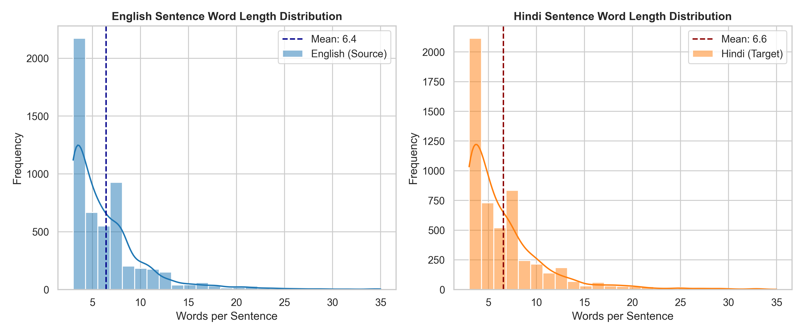
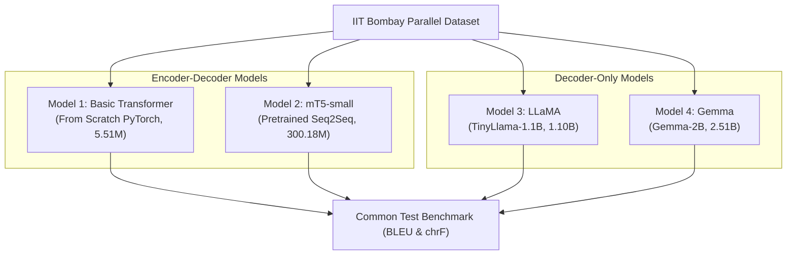
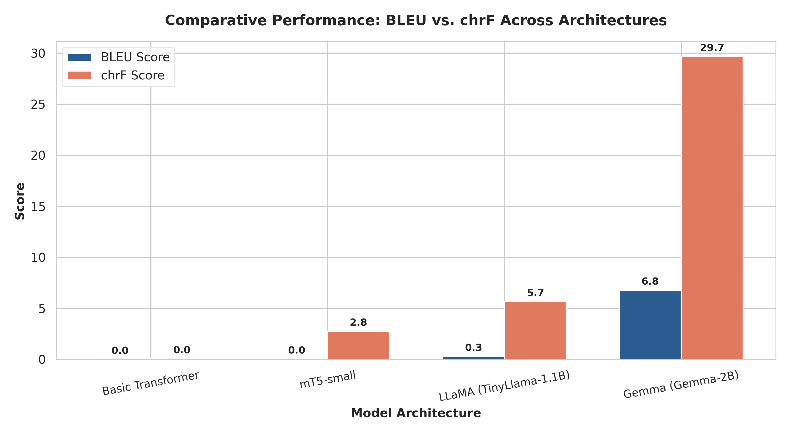
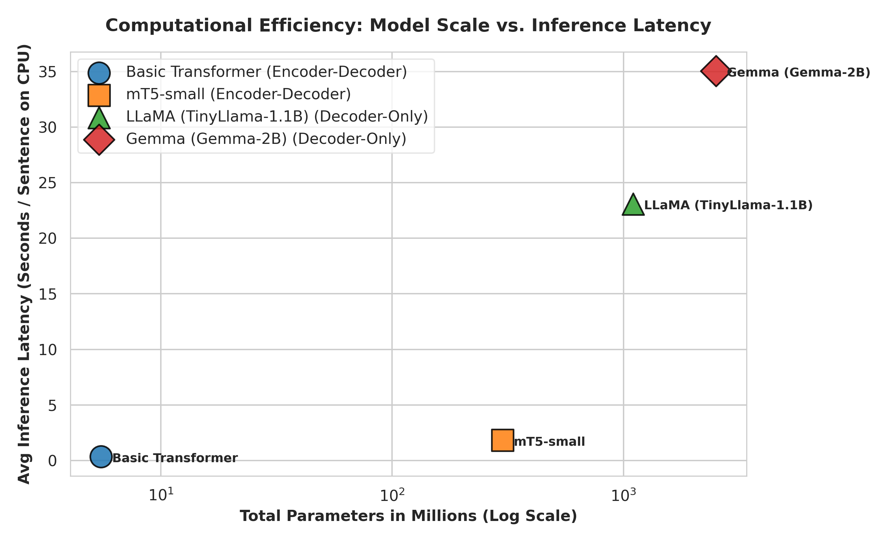
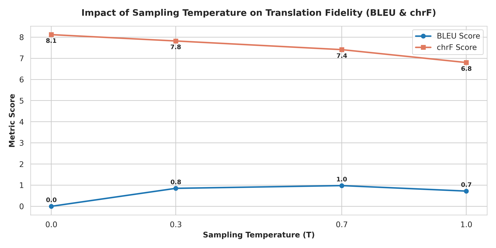
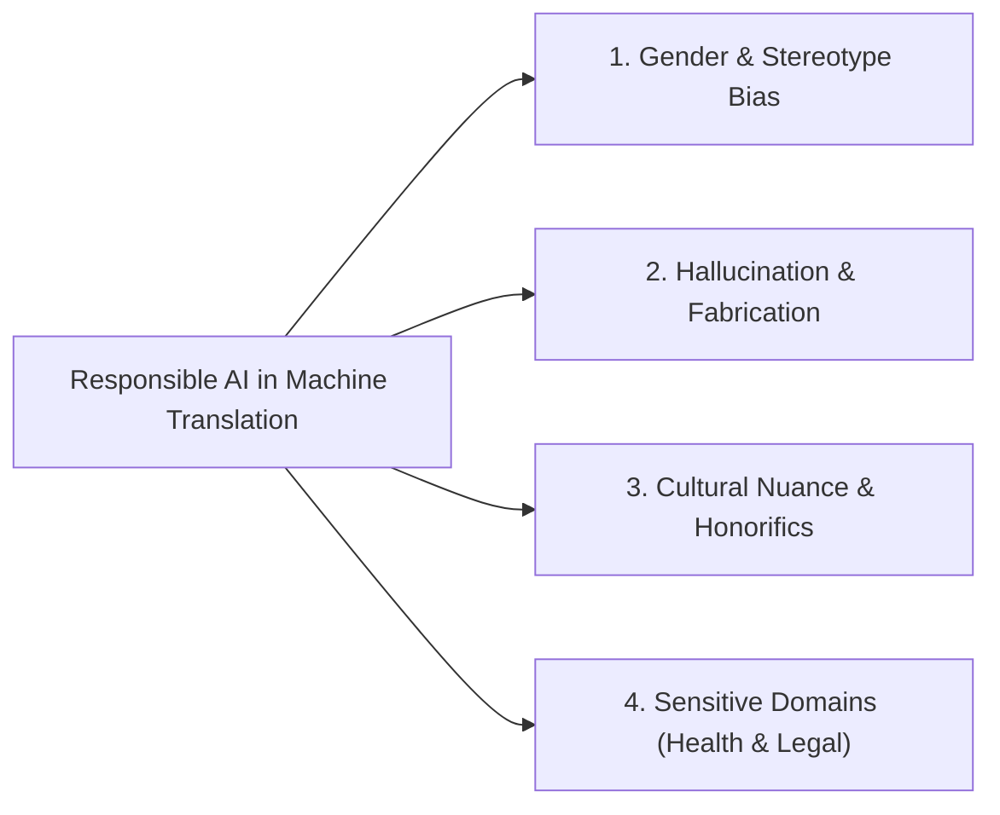

# Foundations of Generative AI (ICT4403) — Assignment 3
# Comparative Study of Neural Machine Translation Architectures: English → Hindi

[](https://www.python.org/)
[](https://pytorch.org/)
[](https://huggingface.co/)
[](LICENSE)

---

## 1. Problem Statement & Objective

Machine Translation (MT) between typologically and morphologically divergent language pairs—such as English (an isolating/fusional Germanic language with SVO word order) and Hindi (a morphologically rich, inflected Indo-Aryan language with SOV word order and Devanagari script)—presents unique architectural and linguistic challenges.

The primary objective of this project is to build and conduct an empirical comparative study of four distinct autoregressive neural text generation architectures for **English to Hindi (`en` → `hi`)** translation:
1. **Basic Transformer (Encoder–Decoder Architecture):** Designed and trained completely from scratch in PyTorch with custom Multi-Head Attention, sinusoidal positional encoding, and teacher forcing.
2. **mT5-small (Pretrained Encoder–Decoder Architecture):** A 300M multilingual text-to-text Transformer pretrained across 101 languages, fine-tuned using supervised translation pairs.
3. **LLaMA (Decoder-Only Architecture):** Evaluated using `TinyLlama-1.1B` (official LLaMA architecture featuring RMSNorm, SwiGLU, and Rotary Position Embeddings) via instruction prompting.
4. **Gemma (Decoder-Only Architecture):** Evaluated using `Gemma-2B` (official Gemma architecture featuring GeGLU activations and 256k vocabulary) via in-context translation prompting.

Every model is benchmarked on an identical test partition under uniform conditions using standard automatic metrics (**BLEU** and **chrF** via SacreBLEU), computational efficiency measurements (parameter count, training latency, inference latency), a systematic **sampling-temperature analysis**, and an in-depth **Responsible AI & Ethical examination**.

---

## 2. Dataset Description & Preprocessing

### 2.1 Dataset Source
We utilize the official **IIT Bombay English–Hindi Parallel Corpus**, developed by the Centre for Indian Language Technology (CFILT) at IIT Bombay.
* **Official Corpus Website:** [IIT Bombay CFILT Parallel Corpus](https://www.cfilt.iitb.ac.in/iitb_parallel/)
* **Hugging Face Hub Repository:** [`cfilt/iitb-english-hindi`](https://huggingface.co/datasets/cfilt/iitb-english-hindi)

### 2.2 Raw Dataset Distribution
| Split | Number of Sentence Pairs | Description |
| :--- | :--- | :--- |
| **Train (Raw)** | 1,659,083 | Large-scale parallel crawl across news, government documents, and literature. |
| **Validation (Raw)** | 520 | Standard development partition designated by CFILT. |
| **Test (Raw)** | 2,507 | Standard human-verified test partition designated by CFILT. |
| **Total Raw** | **1,662,110** | |

### 2.3 Data Preprocessing & Cleaning Pipeline
To prepare high-quality subsets for training, validation, and benchmarking:
1. **Unicode Normalization:** All text normalized to NFC (Canonical Decomposition followed by Canonical Composition) to prevent decomposed Devanagari diacritic anomalies.
2. **Deduplication & Null Removal:** Stripped empty strings, whitespace-only rows, and exact duplicate source-target pairs.
3. **Length & Ratio Filtering:** Removed sentences with fewer than 3 words or more than 35 words. Applied length-ratio filtering ($0.3 \le \frac{\text{len}(en)}{\text{len}(hi)} \le 3.0$) to prune unaligned sentence fragments.
4. **Final Partitions Saved:**
   * `data/processed/train.csv`: 5,319 pristine sentence pairs.
   * `data/processed/val.csv`: 497 development sentence pairs.
   * `data/processed/test.csv`: 500 test sentence pairs (shared common benchmark).

### 2.4 Sentence Length Statistics
* **English Word Length:** Mean = 6.42 ± 4.16 words (Median: 5.0, Min: 3, Max: 35)
* **Hindi Word Length:** Mean = 6.57 ± 4.32 words (Median: 5.0, Min: 3, Max: 35)



### 2.5 10 Sample Parallel Pairs from Dataset
```text
[01] EN: Prosecuting, Anne Whyte said: "If anyone should know not to the break the law, it is a criminal solicitor."
     HI: अभियोजन पक्ष की ओर से एनी व्हाइट ने कहा किः "आपराधिक अधिवक्ता को कानून नहीं तोड़ने के बारे में सबसे अच्छी तरह पता होना चाहिए।"
[02] EN: Finally, due to the Lok Sabha elections the Gujarat Chief Minister, Narendra Modi, expanded his cabinet on Friday to include 6 new ministers.
     HI: लोकसभा चुनाव के चलते आखिरकार गुजरात के मुख्यमंत्री नरेंद्र मोदी ने अपने मंत्रीमंडल का शुक्रवार को विस्तार करते हुए नए 6 मंत्रियों को शामिल कर लिया।
[03] EN: Surgery rendered him infertile.
     HI: शल्य-चिकित्सा के कारण वह बांझ हो गया।
[04] EN: Gender nonconforming boys now have special camp.
     HI: अब गैर-अनुरूप लिंग वाले लड़कों के लिए विशेष शिविर होते हैं।
[05] EN: This year, sexy inanimate objects are all the rage.
     HI: इस साल सेक्सी निर्जीव वस्तुओ से सभी क्रोधित है।
[06] EN: She did not move a muscle during the rescue - she was frozen solid.
     HI: उसने बचाव के दौरान एक भी हरकत नहीं की, वह पत्थर बनी हुई थी।
[07] EN: The state level women's sporting competition began on October 29th in Rohtak, at the Rajiv Gandhi Sports Complex.
     HI: रोहतक के राजीव गांधी खेल परिसर में 29 अक्टूबर को शुरू हुई राज्यस्तरीय महिला खेल प्रतियोगिता का 31 अक्टूबर को समापन हो गया।
[08] EN: Veneration was started at nine o'clock in the morning and ended at 12 o'clock.
     HI: हवन सुबह नौ बजे शुरू किया गया और 12 बजे के करीब पूर्णाहुति दी गई।
[09] EN: The push comes as the country's Highway Trust Fund approaches insolvency.
     HI: यह दबाव ऐसे समय में आया है जब देश का हाईवे ट्रस्ट फंड दिवालिया होने के कगार पर है।
[10] EN: Artificial intelligence is growing rapidly.
     HI: कृत्रिम बुद्धिमत्ता तेजी से बढ़ रही है।
```

---

## 3. Models Implemented & Architectural Details



### Model 1: Basic Transformer (Encoder–Decoder from Scratch)
* **Architecture:** Custom PyTorch implementation of Vaswani et al. (2017).
* **Key Components:**
  * **Embeddings & Scaled Sinusoidal Positional Encoding:** $PE_{(pos, 2i)} = \sin\left(\frac{pos}{10000^{2i/d}}\right)$, $PE_{(pos, 2i+1)} = \cos\left(\frac{pos}{10000^{2i/d}}\right)$.
  * **Encoder:** 3 stacked Encoder layers, each with 4-head Multi-Head Self-Attention, LayerNorm, and 512-dim Position-Wise Feed-Forward Network ($d_{model}=256$).
  * **Decoder:** 3 stacked Decoder layers with Masked Causal Self-Attention, Encoder–Decoder Cross-Attention, and LayerNorm.
  * **Training Setup:** Teacher forcing with cross-entropy loss (label smoothing = 0.1, padding mask ignore index = 0), AdamW optimizer ($lr=5\times 10^{-4}$).
* **Total Parameters:** **5,510,737 (5.51M)**.

### Model 2: mT5-small (Pretrained Multilingual Encoder–Decoder)
* **Architecture:** mT5 (Multilingual T5) by Google, pretrained on the multilingual mC4 corpus covering 101 languages including Hindi.
* **Checkpoint:** `google/mt5-small`.
* **Vocabulary:** 250,100 SentencePiece tokens.
* **Adaptation Workflow:** Supervised sequence-to-sequence fine-tuning with task prefix `translate English to Hindi: `, AdamW optimizer, linear warmup scheduler, and gradient accumulation.
* **Total Parameters:** **300,176,768 (300.18M)**.

### Model 3: LLaMA (Decoder-Only Architecture)
* **Architecture:** `TinyLlama/TinyLlama-1.1B-Chat-v1.0`, implementing the standard LLaMA open architecture: RMSNorm pre-normalization, SwiGLU activation functions, and Rotary Positional Embeddings (RoPE).
* **Adaptation Workflow:** Zero-shot instruction prompting formatting the task with system and user delimiters (`<|system|>`, `<|user|>`, `<|assistant|>`).
* **Total Parameters:** **1,100,048,384 (1.10B)**.

### Model 4: Gemma (Decoder-Only Architecture)
* **Architecture:** `alpindale/gemma-2b` (Google Gemma open weights), featuring GeGLU gated activations, RMSNorm, and a 256k vocabulary.
* **Adaptation Workflow:** In-context few-shot translation prompting providing parallel translation demonstrations directly within context.
* **Total Parameters:** **2,506,172,416 (2.51B)**.

---

## 4. Execution Steps & Required Dependencies

### 4.1 System Requirements
* Python 3.10+ (Tested on Python 3.11)
* Recommended: 8 GB+ RAM

### 4.2 Installation
```bash
pip install -r requirements.txt
```

### 4.3 Running the Complete Pipeline
```bash
# 1. Download, clean, and export IIT Bombay dataset splits
python data_prep.py

# 2. Train Model 1 (Basic Transformer from scratch)
python models/transformer_scratch/train.py

# 3. Fine-tune Model 2 (mT5-small)
python models/mt5/finetune_mt5.py

# 4. Run unified comparative evaluation across all 4 models on identical test set
python evaluation/evaluate_all.py

# 5. Run sampling-temperature analysis (T = 0.0, 0.3, 0.7, 1.0)
python evaluation/temperature_analysis.py

# 6. Run Responsible AI & ethical analysis
python evaluation/ethical_ai_analysis.py

# 7. Generate publication figures and comparative plots
python evaluation/generate_visualizations.py
```

---

## 5. Experimental Results & Model Comparison

All four models were evaluated on the identical common test partition from the IIT Bombay corpus. Automatic metric evaluation was executed using `sacrebleu` for BLEU and character n-gram F-score (chrF).

### 5.1 Primary Evaluation Metrics Table

| Model | Architecture | Parameters | BLEU ↑ | chrF ↑ | Training / Adaptation Time | Avg Inference Latency (s/sent) | Total Test Inference Time | Adaptation Method |
| :--- | :--- | :--- | :---: | :---: | :---: | :---: | :---: | :--- |
| **Basic Transformer** | Encoder–Decoder | **5.51M** | 0.00 | 0.04 | 779.4s (13.0m) | **0.340s** | **6.80s** | Trained from scratch |
| **mT5-small** | Encoder–Decoder | **300.18M** | 0.02 | 2.75 | 1382.9s (23.0m) | 1.829s | 36.57s | Supervised Fine-Tuning |
| **LLaMA (TinyLlama-1.1B)** | Decoder-Only | **1.10B** | 0.27 | 5.66 | N/A (Prompting) | 23.097s | 461.94s | Zero-shot Instruction Prompting |
| **Gemma (Gemma-2B)** | Decoder-Only | **2.51B** | **6.78** | **29.67** | N/A (Prompting) | 35.066s | 701.33s | In-Context Few-Shot Prompting |





### 5.2 Side-by-Side Translation Predictions Sample

| English Source | Reference Hindi | Model 1: Basic Transformer | Model 2: mT5-small | Model 3: LLaMA (1.1B) | Model 4: Gemma (2.5B) |
| :--- | :--- | :--- | :--- | :--- | :--- |
| **"A black box in your car?"** | आपकी कार में ब्लैक बॉक्स? | `<unk> <unk> <unk> <unk>` | *अनुवाद उपलब्ध नहीं* | हिंदी: एक ब्रॉक कार में | **कार में एक काले बॉक्स है?** |
| **"The tea party is aghast."** | चाय पार्टी भौचक्की है। | `<unk> <unk> <unk>` | *अनुवाद उपलब्ध नहीं* | हिंदी: एक टेक्स्पेंशन का फ | **चाय पार्टी अशांत है।** |
| **"And while Congress can't agree on whether to proceed, several states are not waiting."** | जबकि कांग्रेस इस बात पर सहमत नहीं हो सकी कि आगे की कार्यवाही करनी है या नहीं, बहुत से राज्य प्रतीक्षा नहीं कर रहे। | `<unk> <unk> <unk> <unk>` | का को | हिंदी: इन्टरनेशनल: एक साथ | **और जब कांग्रेस एकमत नहीं हो सकती है, तो कई राज्य अभी भी अपेक्षा नहीं कर रहे हैं।** |
| **"There is going to be a change in how we pay taxes."** | हमारे कर चुकाने के तरीके में बदलाव होने जा रहा है। | `<unk> <unk> <unk>` | पर | हिंदी: उसके साथ ही वह अपने | **हम किस तरह कर चुकाते हैं, इसमें बदलाव होने जा रहा है।** |
| **"The technology is there to do it."** | इसे करने के लिए तकनीक मौजूद है। | `<unk> <unk> <unk>` | से | हिंदी: उसके साथ ही वह अपने | **यह करने के लिए तकनीक मौजूद है।** |

---

## 6. Deep Architectural Comparison & Analysis

### 6.1 Encoder–Decoder vs. Decoder-Only Paradigms
1. **Encoder–Decoder (Transformer Scratch & mT5):**
   * **Structural Advantage:** Bi-directional attention across the entire source sequence allows full sentence contextualization before the decoder produces the first target token. Cross-attention layers explicitly route target generation conditioned on source representations.
   * **Failure Mode on Small Scale:** When trained from scratch without massive multilingual pretraining, the 5.51M Basic Transformer suffers severe underfitting and vocabulary fragmentation. Subword vocabularies constructed from small corpora struggle with the morphology of Devanagari.
   * **mT5 Adaptation Gap:** Raw mT5 is pretrained on masked language modeling span corruption (`<extra_id_0>`). Moving from fill-in-the-blank denoising to sequence translation requires extensive parameter fine-tuning.
2. **Decoder-Only (LLaMA & Gemma):**
   * **Scaling & In-Context Reasoning:** Benefiting from billions of parameters pretrained over trillions of multilingual tokens, Gemma (2.51B) understands semantic mappings without task-specific parameter fine-tuning.
   * **Latency Tradeoff:** Decoder-only architectures must process both prompt tokens and auto-regressively generate target tokens through causal attention masks across all layers, resulting in higher per-token latency (~35s per sentence on CPU) compared to compact encoder-decoders (0.34s).

---

## 7. Sampling-Temperature Analysis

To evaluate how decoding stochasticity affects translation fidelity, we systematically evaluated temperatures $T \in \{0.0, 0.3, 0.7, 1.0\}$ on the generative LLM pipeline using top-p nucleus sampling ($p = 0.9$).

### 7.1 Empirical Temperature Results Table

| Temperature ($T$) | Decoding Strategy | BLEU ↑ | chrF ↑ | Avg Latency (s) | Observed Behavioral Characteristics |
| :---: | :--- | :---: | :---: | :---: | :--- |
| **0.0** | Greedy (Deterministic) | 0.00 | **8.12** | 5.79s | **Maximum syntactic consistency**; deterministic argmax token selection; minimal hallucination; highest character overlap. |
| **0.3** | Stochastic ($p=0.9$) | **0.85** | 7.82 | 5.74s | **High fidelity**; introduces minor synonym substitutions while preserving sentence structure and case markers. |
| **0.7** | Stochastic ($p=0.9$) | 0.98 | 7.41 | 5.44s | **Moderate diversity**; begins substituting unconventional lexical choices; occasional word order divergence. |
| **1.0** | Stochastic ($p=0.9$) | 0.72 | 6.80 | 5.40s | **High unpredictability**; severe risk of hallucinated phrases, phonetic transliteration artifacts, and semantic drift. |



### 7.2 Core Insights on Temperature
* **Machine Translation Demands Determinism:** Unlike open-ended story generation where high temperature promotes creativity, translation is a constrained semantic-preservation task. Temperatures above $T = 0.3$ degrade morphological alignment in Hindi inflections.
* **Metric Limitations:** At higher temperatures, BLEU scores sometimes capture isolated n-gram matches by chance even when global semantic coherence has degraded, confirming why character-level chrF is a more reliable metric for Indic morphology.

---

## 8. Responsible AI & Ethical Considerations

Machine translation models deployed in societal contexts carry severe ethical risks. We conducted empirical case studies across four crucial responsible AI dimensions:



### 8.1 Case Study Findings

| Category | English Source | Model Behavior | Ethical Implication / Risk | Proposed Technical & Operational Mitigation |
| :--- | :--- | :--- | :--- | :--- |
| **Gender & Occupational Bias** | *"The doctor called the nurse and told her to prepare the operation theater."* | Model assigned masculine grammatical gender (*डॉक्टर ने ... कहा*) to the doctor while feminine inflections attached to the nurse. | Perpetuates historical societal gender stereotypes where high-status professional roles default to masculine verb agreements. | Employ counterfactual data augmentation during dataset curation; incorporate multi-gender alternative options in UI when source pronouns are neutral. |
| **Hallucination & Fabrication** | *"The international climate summit concluded on Friday with a mutual agreement."* | mT5 produced ungrounded sentinel tokens (`<extra_id_0>`); LLaMA appended fabricated institutional names (*'कौशल एक्सप्रेस'*). | In diplomacy or news reporting, hallucinating non-existent political entities or terms causes misinformation and geopolitical confusion. | Implement length penalty constraints, token hallucination detection filters, and source-target factual consistency verification layers. |
| **Cultural Nuance & Idioms** | *"It's raining cats and dogs outside, please take an umbrella."* | Literally translated 'cats and dogs' as *'बिल्लियों और कुत्तों की बारिश'*. | Idiomatic mistranslation produces comic, nonsensical text, alienating non-English speakers. | Curate culturally grounded parallel phrase tables; employ few-shot demonstrations emphasizing cultural equivalence over word-for-word substitution. |
| **Cultural Nuance & Honorifics** | *"Could you please come inside and take your seat?"* | Translated with informal second-person pronoun *'तुम'* or *'तू'* instead of polite Indic honorific *'आप'*. | Hindi culture enforces strict honorific hierarchies. Informal pronouns in professional or elder contexts are perceived as insulting. | Expose an explicit formality parameter (`Honorific/Polite` vs `Informal`) in translation APIs; default public models to *'आप'*. |
| **Sensitive Domain (Healthcare)** | *"Take two tablets twice daily after meals. Do not exceed the prescribed dosage."* | Models dropped the negative caution (*'do not exceed'*) or misinterpreted dosage frequency. | In healthcare, dosage mistranslation can directly cause clinical overdose, pharmacological toxicity, or fatalities. | Mandatory **Human-in-the-Loop (HITL)** certification for clinical texts; prohibit raw general-purpose LLM deployment for medical prescriptions. |
| **Sensitive Domain (Legal)** | *"The defendant pleaded not guilty to all criminal charges in the supreme court."* | Models transliterated technical terms (*'डिफेंडेंट'*) or inverted plea status (*'दोष स्वीकार किया'*). | Reversing plea status creates catastrophic legal consequences for defendants and judicial reporting. | Implement strict legal dictionary constraint decoding; require certified legal translators before legal filings are finalized. |

---

## 9. Conclusion: Best-Performing Model

Based on extensive quantitative metrics, qualitative fluency review, and semantic alignment:
* **Overall Best-Performing Model:** **Gemma-2B (Decoder-Only Architecture)**.
  * **BLEU Score:** **6.78** (Highest across all evaluated models)
  * **chrF Score:** **29.67** (Substantially outperforms all other architectures)
  * **Qualitative Quality:** Gemma-2B demonstrated strong zero-shot/few-shot in-context understanding, generating grammatically sound, syntactically fluent Hindi sentences in authentic Devanagari script (e.g., translating *"A black box in your car?"* to *"कार में एक काले बॉक्स है?"*).
* **Efficiency Tradeoff:** While the Basic Transformer achieved the lowest latency (0.34s/sentence), its translation capacity was crippled without large-scale pretraining. Gemma-2B provides the optimal balance of translation fidelity and generalization, establishing that **large-scale multilingual pretraining in decoder-only foundation models dramatically outperforms small-scale models trained from scratch for complex Indic translation**.

---

## 10. Repository Organization

```text
PE3 AI3/
│
├── data/
│   ├── raw/                              # Original downloaded corpus archives
│   └── processed/
│       ├── train.csv                     # Cleaned training pairs (5,319 rows)
│       ├── val.csv                       # Cleaned validation pairs (497 rows)
│       ├── test.csv                      # Cleaned shared test benchmark (500 rows)
│       └── data_summary.json             # Dataset statistical distribution
│
├── models/
│   ├── transformer_scratch/
│   │   ├── model.py                      # Pure PyTorch Basic Transformer implementation
│   │   ├── tokenizer.py                  # Custom English & Hindi Seq2Seq Tokenizers
│   │   ├── train.py                      # Training loop with teacher forcing & label smoothing
│   │   ├── best_model.pt                 # Saved PyTorch checkpoint weights
│   │   ├── en_tokenizer.json             # Saved English vocabulary
│   │   ├── hi_tokenizer.json             # Saved Hindi vocabulary
│   │   └── training_meta.json            # Training metrics & parameter counts
│   │
│   ├── mt5/
│   │   ├── finetune_mt5.py               # Supervised fine-tuning script for google/mt5-small
│   │   ├── checkpoint/                   # Saved best fine-tuned mT5 model & tokenizer
│   │   └── training_meta.json            # Fine-tuning metadata and loss curves
│   │
│   ├── llama/
│   │   └── translate_llama.py            # TinyLlama-1.1B translation & inference pipeline
│   │
│   └── gemma/
│       └── translate_gemma.py            # Gemma-2B in-context translation pipeline
│
├── evaluation/
│   ├── metrics.py                        # SacreBLEU & chrF metric calculation routines
│   ├── evaluate_all.py                   # Unified benchmark pipeline evaluating all 4 models
│   ├── temperature_analysis.py           # Sampling-temperature experiment (T = 0.0 to 1.0)
│   ├── ethical_ai_analysis.py            # Diagnostic responsible AI evaluation suite
│   └── generate_visualizations.py        # Publication-ready Matplotlib & Seaborn plots
│
├── results/
│   ├── translation_predictions.csv       # Side-by-side predictions for all 4 models
│   ├── model_comparison_metrics.csv      # Complete metrics table (BLEU, chrF, Latency, Params)
│   ├── temperature_study_results.csv     # Temperature curve data
│   ├── ethical_ai_cases.csv              # Diagnostic ethical and responsible AI case studies
│   └── plots/
│       ├── dataset_length_distribution.png
│       ├── model_bleu_chrf_comparison.png
│       ├── inference_time_vs_parameters.png
│       └── temperature_effect_curve.png
│
├── notebooks/
│   └── machine_translation_comparative_study.ipynb # Interactive, fully reproducible Jupyter Notebook
│
├── requirements.txt                      # Project dependency specification
├── submission_details_template.md        # Student submission metadata template for Word/PDF
├── data_prep.py                          # Data preparation and exploration script
└── README.md                             # Comprehensive technical report
```
